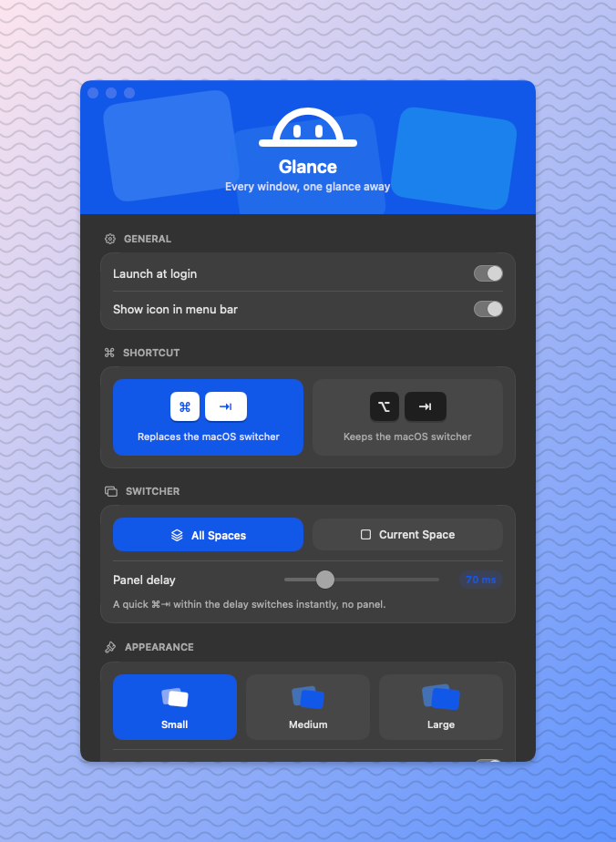

<p align="center">
  
</p>

<h1 align="center">Glance</h1>

<p align="center">
  A tiny, fast, Windows-style window switcher for macOS.<br>
  Press <b>⌘⇥</b> to see every window, with live thumbnails, not just every app.
</p>

<p align="center">
  
  
  
  
</p>

<p align="center">
  
</p>

## Usage

| Keys | Action |
| --- | --- |
| `⌘⇥` (tap) | Jump to the previous window instantly; no UI appears |
| `⌘⇥` (hold ⌘) | Show the switcher; each `⇥` moves forward |
| `⌘⇧⇥` | Move backward |
| `←` `→` `↑` `↓` | Navigate while the switcher is open |
| Release `⌘` / `↩` | Switch to the selected window |
| `esc` | Cancel |
| Mouse | Hover to select, click to switch |
| Drag + `⌘⇥` | While dragging a file, text or image: the panel stays open; release `⌘`, then hover the drag over a window for a moment (or drop on it) to bring that window forward, then drop into it. Nothing switches while `⌘` is still held |

Glance lives in the menu bar (no Dock icon). Its menu has **Settings…** (⌘,),
**Check for Updates…** and **Quit**, plus a warning item if a permission is
missing and a **Glance X.Y.Z Available…** item when there's a newer release.

## Settings

| Section | Options |
| --- | --- |
| General | Launch at login · Show icon in menu bar |
| Shortcut | `⌘⇥` (replaces the macOS app switcher) or `⌥⇥` (keeps it) |
| Switcher | Show windows from all Spaces or the current Space only · Panel delay (0–300 ms; a quick tap within it switches without showing the panel) |
| Appearance | Theme (System / Light / Dark, for the switcher and Settings) · Show as window thumbnails or app icons (one tile per window either way) · Size (small / medium / large) · Show window titles |
| Excluded Apps | Apps whose windows never appear in the switcher |
| Permissions | Accessibility and Screen Recording status, with shortcuts to fix them |
| Updates | Check for updates automatically (on by default) · Check Now / Download |

Changes apply immediately. While Settings is open, Glance shows in the Dock and in
⌘⇥ (Glance's switcher and the macOS one) like a regular app, with ⌘W to close.
It goes back to living only in the menu bar when you close Settings. If you hide
the menu bar icon, open Glance again (from
Spotlight or Finder) to bring up Settings. Settings also opens on first
launch, until Accessibility is granted.

## Install

Download `Glance.dmg` from the
[latest release](https://github.com/edwinencomienda/glance/releases/latest),
open it and drag Glance to Applications. It's signed and notarized by Apple.
Requires macOS 14+.

### Updates

Glance asks GitHub for the latest release when it starts, and when you open its
menu or Settings, at most once a day. When there's a newer version, the menu bar
menu shows **Glance X.Y.Z Available…**, which opens the release page; download
the DMG and drag Glance to Applications to replace the old copy. Glance never
downloads or installs anything by itself, and it sends nothing but a standard
request for the latest release. Turn automatic checks off in Settings → Updates;
**Check for Updates…** still works.

## Build from source

```sh
scripts/build-app.sh            # builds build/Glance.app
scripts/build-app.sh --install  # builds, copies to /Applications, launches
```

Requires macOS 14+ to run, and Xcode 26+ to build.

## Development

See [docs/DEVELOPMENT.md](docs/DEVELOPMENT.md) for the dev loop, debugging and
testing, [docs/RELEASING.md](docs/RELEASING.md) for versioning and releases,
[CHANGELOG.md](CHANGELOG.md) for what changed, and [docs/ARCHITECTURE.md](docs/ARCHITECTURE.md) for how it works.
Run the tests with `swift test`.

## Permissions

- **Accessibility**: needed to intercept ⌘⇥ and raise the chosen window.
- **Screen Recording**: needed for thumbnails and window titles.

Grants are tied to the code signature. Release downloads keep the same
signature across updates. For your own builds, the build script signs with your first
`Apple Development` identity, so grants survive rebuilds. If there isn't one, it
falls back to ad-hoc signing, and you'll need to re-grant after each rebuild. Set
`GLANCE_SIGN_IDENTITY` to choose an identity.

## How it stays fast

- **Window list**: two `CGWindowListCopyWindowInfo` calls plus a cheap Space
  lookup per window, about 5 ms for every window on every Space. Windows are
  ordered most recently used first. No per-app Accessibility IPC on open.
- **Delayed panel**: the panel appears after 70 ms, so a quick tap never draws.
- **Thumbnails**: captured in parallel with ScreenCaptureKit, at the exact pixel
  size shown. Cached per window, so the panel opens with the last frame and
  updates in place.
- **Geometry**: computed once up front. The panel is sized in one step, and
  mouse hit-testing is plain arithmetic.
- **Focusing**: runs on a background queue with a 250 ms AX timeout, so a hung
  app can't freeze the switcher.
- **Idle cost**: zero. No timers or polling, just an event tap.

## Notes & limitations

- In secure text fields (e.g. password inputs), macOS hides keystrokes from apps.
  ⌘⇥, ⌘⇧⇥ and ⇥-cycling still work, and so do ⌘+Esc / ⌘+↩ / ⌘+arrows while ⌘ is
  held. Glance never reads what you type.
- Lists windows on every Space, including full-screen apps. Minimized windows,
  hidden apps (⌘H) and inactive native tabs aren't listed.
- Uses private SkyLight APIs to disable the native ⌘⇥ and to
  focus a specific window. They're loaded at runtime, so if they're missing it
  falls back to public APIs instead of crashing. Native ⌘⇥ is restored on quit,
  including on SIGTERM/SIGINT. After a hard crash (SIGKILL), relaunch Glance and
  quit it, or log out, to get native ⌘⇥ back.

## License

[MIT](LICENSE) © Edwin Encomienda
